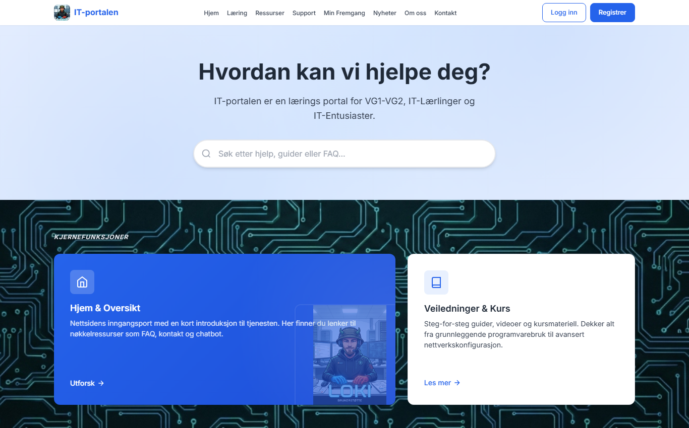
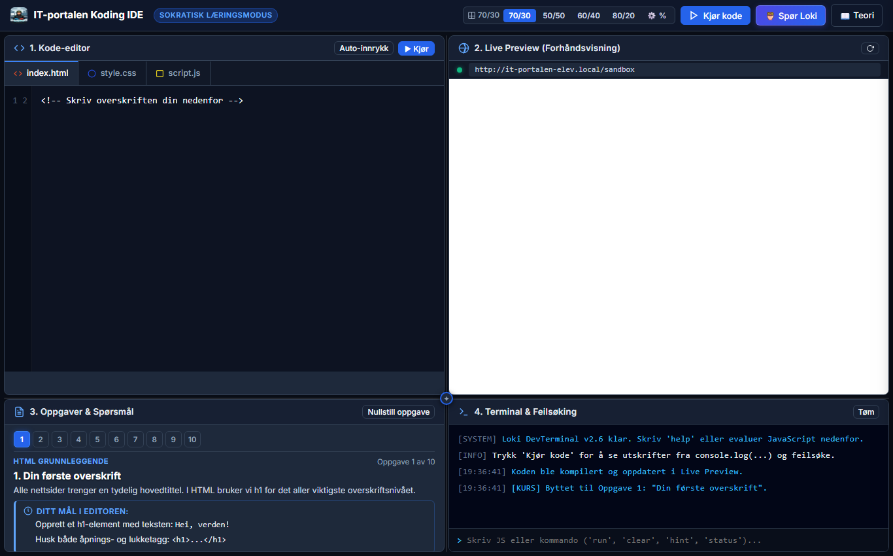
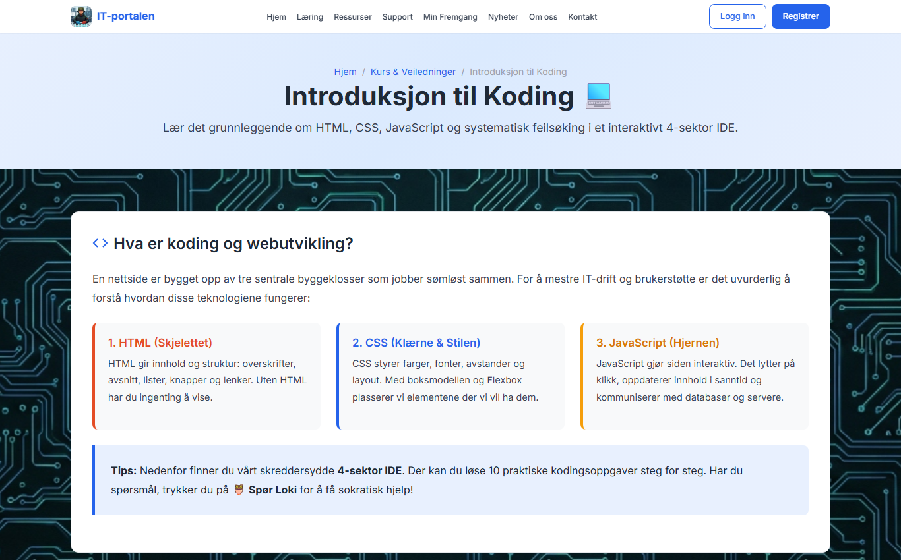

# IT-portalen 🚀

**IT-portalen er en norsk læringsportal der VG1/VG2-elever, IT-lærlinger og nysgjerrige lærer IT og koding i nettleseren, med en AI-tutor som gir hint i stedet for fasit.**

🔗 **Live:** _kommer_ · 👤 **Demo-bruker:** _kommer_



## Hva kan du gjøre i portalen?

- **Lære å kode i nettleseren:** En innebygd IDE med HTML/CSS/JS-editor, live forhåndsvisning, terminal og ti oppgaver i stigende vanskelighetsgrad.
- **Få hjelp av Loki-tutoren:** AI-tutoren (Google Gemini) ser koden og feilmeldingene dine og svarer med hint og forklaringer, ikke ferdig kode.
- **Lese guider:** Over 20 artikler om IT-drift, sikkerhet, personvern (GDPR/EKOM), etikk og kommunikasjon, med søk på forsiden.
- **Følge med på egen fremgang:** Kursfremgang og quiz-resultater lagres per bruker.
- **Be om brukerstøtte:** Et ticket-system og en chatbot for vanlige IT-spørsmål.
- **Følge med som lærer eller admin:** Et dashboard med elevoversikt, fremgang per elev, tickets, tilbakemeldinger og statistikk.

| Koding-IDE med Loki-tutor | Kodekurs |
| --- | --- |
|  |  |

## Teknologi

| Del | Valg |
| --- | --- |
| Frontend | HTML5, CSS3 (eget designsystem), vanilla JavaScript (ES6+) |
| Backend | Node.js med Express 5, express-session, bcrypt |
| Database | MySQL (mysql2), lokalt eller på Aiven |
| AI | Google Gemini via `@google/genai` |
| Agent-verktøy | MCP-server (`mcp/`) som simulerer elever og tickets for testing av lærer-dashboardet |

## Kom i gang lokalt

**Du trenger:** [Node.js](https://nodejs.org/) (LTS) og MySQL/MariaDB (for eksempel via XAMPP).

```bash
git clone https://github.com/Loki-of-Norway/antigravity_IT-portalen.git
cd antigravity_IT-portalen
npm install
cp .env.example .env              # fyll inn egne verdier
node scripts/run_sql.js database.sql
node scripts/seed_admin.js        # oppretter admin fra ADMIN_* i .env
npm start
```

Åpne deretter `http://localhost:3000`.

## Deploy (Render)

Repoet har en `render.yaml`. Gjør slik:

1. Opprett en ny **Blueprint** på [Render](https://render.com) og koble den til dette repoet.
2. Fyll inn `DB_*` (for eksempel fra Aiven) og `GEMINI_API_KEY` i dashboardet. `SESSION_SECRET` genereres automatisk.
3. Kjør `scripts/run_sql.js` og `scripts/seed_admin.js` én gang mot databasen fra din egen maskin, med de samme verdiene i `.env`.

## Struktur

```
├─ server.js        Express-server og alle API-ruter
├─ database.sql     Tabeller for brukere, kurs, tickets, chat m.m.
├─ index.html       Forside
├─ pages/           Artikler, kategorier, tjenester og IDE
├─ admin/           Admin- og lærer-dashboard
├─ css/ js/         Designsystem og frontend-logikk
├─ mcp/             MCP-server for elevsimulering
├─ scripts/         Hjelpeskript for database og admin-bruker
└─ docs/            Prosjektbeskrivelse, oversikt og videre planer
```

Mer om bakgrunn, valg og refleksjoner står i [docs/PROSJEKTBESKRIVELSE.md](docs/PROSJEKTBESKRIVELSE.md). Planer for videre utvikling står i [docs/FremtidigeOppgraderinger.md](docs/FremtidigeOppgraderinger.md).

## Forfatter

**Theodor "Loki" Kvalem**: tidligere sveiser, nå IT-utvikler under utdanning, på jakt etter læreplass.
